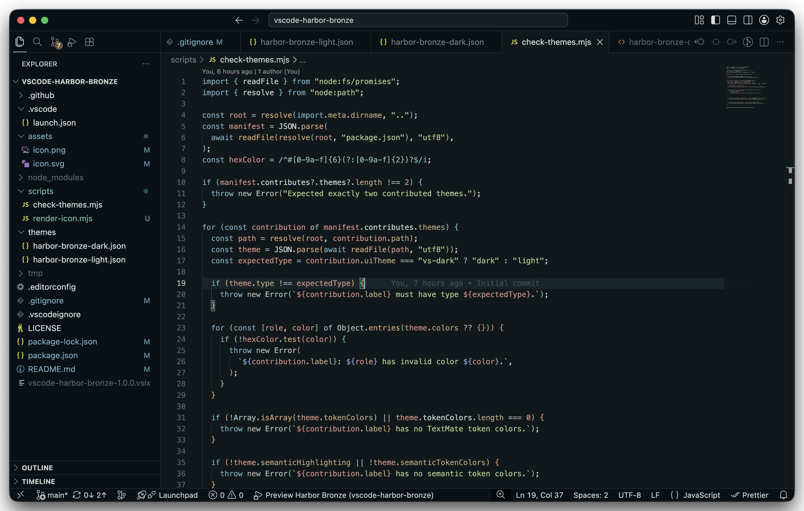
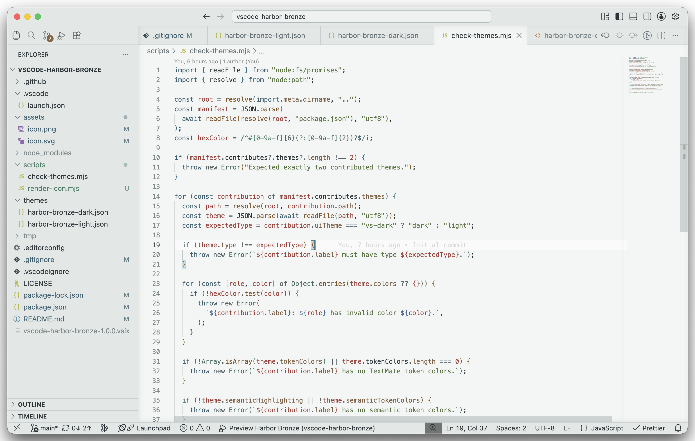

# Harbor Bronze for VS Code

A cool, desaturated harbor palette with teal structure and warm bronze accents.

The theme comes in two variants: **Dark** and **Light**.

## Screenshots





## Install locally

Build the extension and install the generated VSIX:

```sh
npm install
npm run package
```

In VS Code, open the Extensions view, choose **Install from VSIX…**, and select the generated file. Then run **Preferences: Color Theme** and choose either Harbor Bronze variant.

## Development

Open this repository in VS Code and press `F5` to launch an Extension Development Host. Theme file changes are reflected in the development window.

Validate the manifest and theme colors with:

```sh
npm run check
```

After changing `icon.svg`, run to regenerate the `icon.png` from it:

```sh
npm run icon
```

## Change log

See [CHANGELOG.md](CHANGELOG.md).

## License

Please see [LICENSE](./LICENSE)

### Enjoy!
